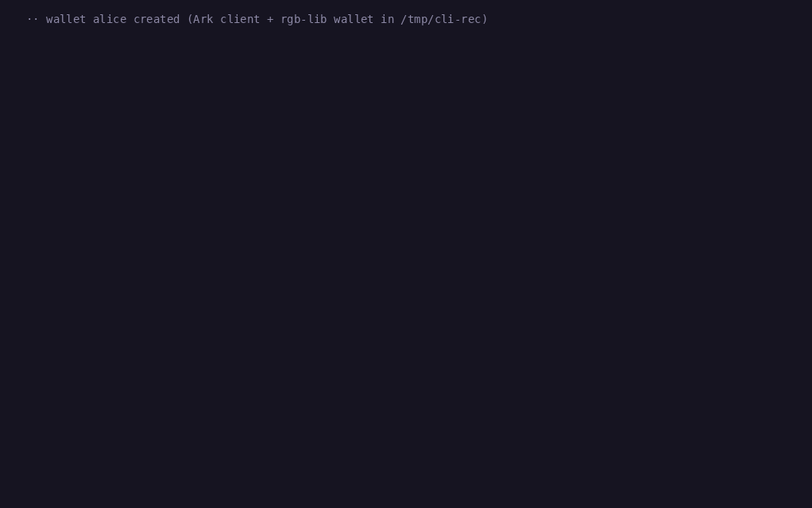

# rgb-arkade

RGB assets in [Arkade](https://github.com/arkade-os/arkd) VTXOs, on regtest. Assets enter Arkade, move off-chain in preconfirmed Arkade transactions, swap atomically for bitcoin, survive batch expiry and leave on-chain. Receivers validate client-side from a consignment plus an Ark proof, without contacting the operator.

It is a set of patches to arkd, the Ark rust-sdk and rgb-lib, and a demo client (`ark-rgb-demo`) that runs every flow end to end.

> Research prototype, regtest only, not production ready.



*Two wallets on regtest (full patch set): Alice issues an asset, sends Bob 300 units off-chain, sells him 200 for 20,000 sat in one Arkade tx, refreshes her VTXO, exits unilaterally and sends the rest on-chain. Waits shortened; raw recording in [docs/media/rgb-arkade-cli.cast](docs/media/rgb-arkade-cli.cast).*

## Outcome

RGB requires the tx that spends a seal to carry the commitment. In Arkade a VTXO is spent by a checkpoint (off-chain send), a forfeit (batch) or the user's exit spend, and arkd builds the first two from fixed templates. What each level of arkd support allows ([docs/approaches.md](docs/approaches.md) has every test and trade-off):

| Lane | arkd | What works | Main limit |
|---|---|---|---|
| Stock | unmodified | Jump-in, one off-chain hop (also one leg of a swap), unilateral exit | One hop, then out before expiry |
| **Checkpoint only (B)** | one opt-in change: [`patches/arkd-checkpoint.patch`](patches/arkd-checkpoint.patch), 5 files, +86/−11 on master | Any number of hops, renewal before expiry, atomic swaps, payments to receivers with no VTXO, delegated renewal, keyless watchtower exit. Standard RGB | No batch refresh or sweep recovery; an owner offline past about one extra batch period loses the asset unless a funded watchtower exits it; after an exit, on-chain receivers need the Ark proof |
| Full patch set (A + B + C) | [`patches/arkd.patch`](patches/arkd.patch) on arkd v0.9.15: A, B, C, plus `forfeit-cosign` and `recovery-forfeit` (needed for sweep recovery) ([PATCHES.md](PATCHES.md#arkd)) | Also: receive on a new output in one tx, batch refresh, collaborative exit, recovery after a sweep | Forfeits carry data; seal uniqueness of unmined forfeits depends on the operator; recovery after a sweep needs the operator to cooperate |
| Look-through | unmodified | Renewal and multi-hop on stock arkd | Needs a new RGB consensus rule ([experiment](experiments/look-through/README.md)) |

Suggested order: B, then A, then C, each as a separate change with its own use case. Unilateral exit stays the rescue path in every lane.

A + B + C rebased on arkd master (no `forfeit-cosign` or `recovery-forfeit`) is the branch [`rgb-opret-data-outputs`](https://github.com/bitwalt/arkd/tree/bee4a07bc9135c08d229c19e7c4b97d3dba82b8b) of the arkd fork; the quick-suite result on master in [docs/test-results.md](docs/test-results.md) comes from that branch, not from a patch in this repository.

### An owner who stays offline

No lane keeps an asset alive for an unbounded absence on its own. What it takes, per lane (details in [docs/approaches.md](docs/approaches.md#offline-users-with-b-only)):

| Absence | Checkpoint only (B) | Full patch set (A + B + C) |
|---|---|---|
| Less than one batch period | The owner renews on return | Renews or refreshes on return |
| Up to about one extra period | A delegate submits a pre-signed renewal | Same |
| Longer, e.g. 2 months | Only a keyless watchtower that exits the VTXO on-chain before expiry, with funds for the fees (about 550–650 sat per tree level at 2 sat/vB). Without it the batch is swept and the asset is lost | The watchtower exit as in B, or recovery after the sweep, which works only if the operator accepts the recovery intent. If the operator refuses, the asset cannot be moved again |

The 64-day `sweep-recovery` run (full patch set, time-scaled) shows the cooperative case only.

## Quickstart

Requirements: Linux or macOS, docker, Go ≥ 1.26.6 (arkd v0.9.15 needs 1.26.5, master 1.26.6), rustup (pins Rust 1.96.0), node ≥ 20, git, python3, curl; about 5 GB of disk.

```bash
make setup                                # clone pinned upstreams, apply patches, build arkd:rgb and the demo
make regtest-up                           # regtest stack on the full patch set
make scenario SCENARIO=offchain-transfer  # make list shows every scenario
```

Checkpoint-only lane:

```bash
make setup-cponly                         # arkd master + patches/arkd-checkpoint.patch -> arkd:rgb-cponly
make regtest-up-cponly
make scenario SCENARIO=checkpoint-swap    # also checkpoint-renew, checkpoint-offline
```

Each run writes `state/run-<ts>-<scenario>/` (wallets, consignments, proofs, `summary.json`) and ends with `<NAME> RESULT: PASS`. On hosts whose iptables FORWARD policy is DROP: `iptables -I FORWARD 1 -s 172.16.0.0/12 -d 172.16.0.0/12 -j ACCEPT`.

## CLI

An interactive shell over the same flows as the web app, with two wallets (`alice`, `bob`), on the full patch set:

```bash
demo/target/debug/ark-rgb-demo cli        # wallets in state/cli, step details in state/cli/cli.log
```

| Command | What happens |
|---|---|
| `board <who> [sats]` | Board bitcoin into a batch |
| `issue <who>` | Issue 1000 units on-chain and move them onto the wallet's VTXO |
| `balance [who]` | Bitcoin, VTXOs and assets |
| `send <from> <to> <amount>` | Off-chain transfer; the receiver validates with arkd paused |
| `swap <seller> <buyer> <amount> <price>` | Asset for bitcoin in one Arkade tx |
| `refresh <who>`, `collab-exit <who>` | Batch operations; the forfeit carries the transition |
| `exit <who>`, `onchain-send <from> <to>` | Unilateral exit, then an on-chain RGB transfer |
| `recover <who>` | Recover a VTXO swept after expiry, asset included |
| `mine [n]`, `reset`, `help`, `quit` | Regtest and session controls |

```text
rgb-ark> send alice bob 300
  ·· T1 in the checkpoint tx, T2 in the Arkade tx: 300 to bob (vout 1), 700 change to alice (vout 2)
  tx checkpoint tx (T1): 4ae67035f4730a1716b838b9d3157c2f329c62ee57c46c3dcf914e28847fb868
  tx Arkade tx (T2): 89b8520783d28350fcf5fad1e7826cf6cd369137a0f80a02569338be1eb2fd2f
  ·· arkd PAUSED: bob validates from consignment + Ark proof + bitcoin chain only
  ·· bob received 300 off-chain
done: alice -> bob: send 300 off-chain (6 s)
```

The web app (`make app`, http://127.0.0.1:8080) drives the same flows with buttons, shows both wallets side by side, and has a demo mode that runs the main flow in about a minute.

| Option | Effect |
|---|---|
| `--data-dir=<path>` or `RGB_ARKADE_APP_DATA` | Data dir (default `state/app-data`): wallet keys and mnemonics, rgb-lib data, consignments, proofs, `app.json`. Must be new, empty, or one the app created: Reset deletes it, so the app marks it (`.rgb-arkade-data`) and refuses any other non-empty dir. The CLI's `[dir]` works the same way. |
| `RGB_ARKADE_BIND` | Listen address (default `127.0.0.1`). |
| `--public` or `RGB_ARKADE_PUBLIC=1` | Public demo mode: every visitor (by cookie) gets their own throwaway wallet pair, dropped after `RGB_ARKADE_SESSION_TTL` s idle (default 2 h), at most `RGB_ARKADE_MAX_SESSIONS` (40); regtest controls are off except mining a few blocks, and a background miner runs every `RGB_ARKADE_AUTOMINE` s (60). **Anyone who can reach the port can create wallets and run every flow against your regtest stack** (mining, boarding, exits, swaps), and the server holds all their keys. Use it only on regtest, behind a reverse proxy with rate limits, never with real funds. |
| `RGB_ARKADE_EXPLORER` | URL prefix for transaction links (e.g. `https://<host>/tx/`); default: the regtest stack's local explorer. |

Endpoints (app, CLI and scenarios): `RGB_ARKADE_ARKD_URL` (default `http://localhost:7070`), `RGB_ARKADE_ESPLORA_URL` (`http://localhost:3000/api`), `RGB_ARKADE_BITCOIND_URL` (`http://localhost:18443`), `RGB_ARKADE_ELECTRUM_URL` (`tcp://localhost:50001`). `RGB_ARKADE_MIN_LIFETIME_BLOCKS` / `RGB_ARKADE_MIN_LIFETIME_SECS` make receivers reject a VTXO with less time left before its batch can be swept (off by default: the scenarios use expiries of minutes).

The demo takes the operator keys to pin from arkd's `GetInfo` when a wallet is created. A real wallet must pin them out of band and keep the old keys after a rotation: proofs of earlier transfers are signed with them.

## Arkade Intents solver (demo)

`intents/solver.mjs` runs a minimal Nostr relay and a solver on it, so a wallet can buy an RGB asset over the Arkade Intents (`@arkade-os/swap`) RFQ wire. The solver publishes a card (kind 38859) for `arkade:RGB:*->arkade:BTC`, answers sealed RFQs (kind 24859, NIP-44) with a fixed price per unit, and settles through the app's one-tx atomic swap, as wallet `bob`. Relay events are signature-checked, and only browser-extension or origin-less clients may connect.

```
cd intents && npm install && node solver.mjs   # relay on ws://127.0.0.1:7447, app on http://127.0.0.1:8080
```

Env: `SOLVER_RELAY_PORT`, `SOLVER_APP_URL`, `SOLVER_PRICE` (sat per unit, default 100), `SOLVER_KEY_FILE` (default `state/intents-solver.key`). Demo only: one solver, one buyer wallet, no persistence beyond the key.

## Scenarios

`scripts/run-scenario.sh <name>` runs one scenario and handles expiry changes, a background miner and watchtower daemons; `scripts/run-all.sh [quick|all|cponly|stock|full]` runs a suite: `quick` (`make test`) is the full patch set without the time-scaled scenarios, including `swap` and the `--offline-proof` variants; `all` (`make test-all`) adds the time-scaled ones; `cponly` and `stock` run the other lanes on their stacks; `full` (`make test-full`) runs every lane, restarting the stack clean with each profile.

| Scenario | Checks |
|---|---|
| `basic`, `basic-onchain-genesis` | Jump-in, one hop, unilateral exit, on-chain send |
| `offchain-transfer` | Two hops with asset change, exit, on-chain send |
| `refresh`, `collab-exit` | Commitment in the forfeit |
| `forfeit-negatives` | Malformed or unattested commitments rejected |
| `multi-user`, `failed-batch` | Batches with several users and assets; rollback of a failed round |
| `fraud` | Colluding operator: fraud proof verified offline |
| `sweep-recovery` | Asset recovered after the batch is swept |
| `long-offline`, `exit-watchtower` | Keyless watchtower exit before expiry |
| `swap` | Asset for bitcoin in one Arkade tx; refusal before signing rolls back |
| `multihop-exit` | App flows headless, exit of a multi-hop asset |
| `stock-lane`, `opret-probe` | Unmodified arkd (`REGTEST_PROFILE=stock`): one hop and a swap; which `OP_RETURN` shapes arkd takes |
| `checkpoint-renew`, `checkpoint-swap`, `checkpoint-offline` | Checkpoint only (`make regtest-up-cponly`): renewal, swap, payment to a receiver with no VTXO, delegated renewal, watchtower exit |

`basic*`, `offchain-transfer`, `refresh` and `collab-exit` also run with `--offline-proof` (receivers validate with arkd paused; tampered proofs rejected). Results: [docs/test-results.md](docs/test-results.md).

## Limitations

- Regtest only; none of the patches are upstream.
- No direct boarding of a colored UTXO; assets enter with a jump-in.
- rgb-lib integration is partial: Ark state lives in JSON files in the wallet dir, `get_asset_balance_ark` replaces the stock balance, rollback is a manual call, Electrum only.
- History grows with every transfer; exit cost grows with the number of unmined hops.
- An asset output carrying 1,000 sat (the buyer's side of a swap) can exit, but its on-chain spend needs a funding input the demo does not add.
- The demo is a test harness, not a wallet.

Security model and trade-offs: [docs/design.md](docs/design.md#security-model).

## Repository layout

| Path | What |
|---|---|
| `patches/`, `PATCHES.md` | One patch per upstream (arkd full set, arkd checkpoint only, rust-sdk, rgb-lib, arkade-regtest) |
| `arkd-image/`, `arkd-image-cponly/` | `arkd:rgb` and `arkd:rgb-cponly`: upstream image with the patched binary |
| `demo/` | `ark-rgb-demo`: scenarios (one module each), `cli`, `app`, `watchtowerd`, `bench` |
| `scripts/`, `Makefile` | Setup, regtest stack, scenario runners, patch checks |
| `docs/` | `approaches.md`, `design.md`, `test-results.md`, `media/` |
| `intents/` | Demo Arkade Intents solver and relay |
| `experiments/` | Look-through experiment: rgb-consensus and rgb-psbt-utils patches, results |
| `tools/`, `bench/`, `pools/` | Colluding-operator test tool, benchmark analysis, offline mempool pools mirror (`pools-v2.json` from [mempool/mining-pools](https://github.com/mempool/mining-pools), MIT) |

Generated, not committed: `vendor/`, `arkade-regtest/`, `state/`, `logs/`, `watchtowerd/`, the arkd binaries, `demo/target/`.

To change upstream code: edit `vendor/<repo>`, then `git -C vendor/<repo> diff > patches/<repo>.patch` (`git add -N` new files first) and `make patches-check`. `make setup` notices a changed patch (stamps in `vendor/.stamps/`): a checkout that already matches it is kept, one with other changes stops the setup until you regenerate the patch or rerun with `RESET_VENDOR=1`.

## License

MIT, see [LICENSE](LICENSE). The patched upstreams (arkd, rust-sdk, rgb-lib) are MIT as well.
