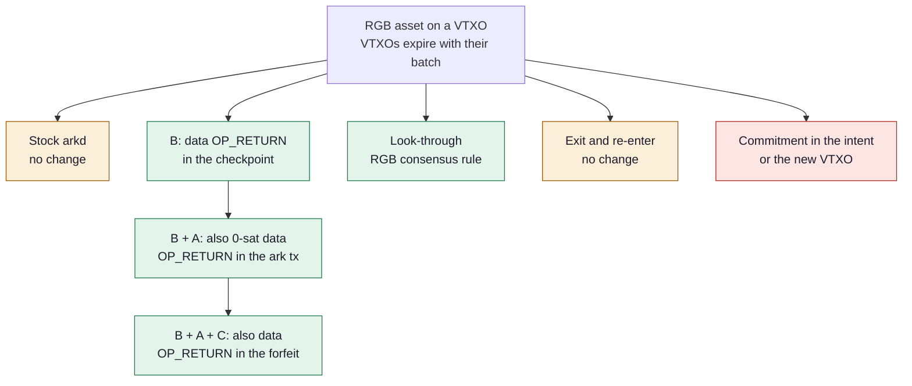
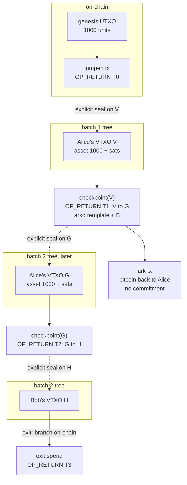

# Approaches compared

Every way we tried to run RGB assets on Arkade, what each needs changed, what was measured, and the trade-offs. Raw numbers and txids are in [test-results.md](test-results.md).

## The problem

RGB binds an asset to an outpoint, and the tx that spends that outpoint must carry the RGB commitment. In Arkade a VTXO is spent by a checkpoint (every off-chain send), a forfeit (refresh, collaborative exit) or an exit tx (unilateral exit). arkd builds the checkpoint and the forfeit from fixed templates, and VTXOs expire with their batch: after expiry the operator sweeps the batch and an asset left on it can never move again.

## Overview

Green: measured end to end. Amber: works with hard limits. Red: dropped.

## How an asset moves (checkpoint-only lane)

Solid arrows are bitcoin spends, dotted arrows are where the RGB state goes. The asset never rides the batch tree itself: it sits on an ordinary VTXO and moves through the checkpoint that spends it. Receivers get a consignment plus an Ark proof (the co-signed checkpoints down to a mined batch commitment).

## What each one can do

| | Stock | B | B + A | B + A + C | Look-through | Exit and re-enter |
|---|---|---|---|---|---|---|
| arkd change | none | 1 opt-in | 2 opt-in | 3, forfeit included | none | none |
| RGB change | none | none | none | none | 1 seal-closing rule | none |
| Off-chain hops | 1 | any | any | any | any | 1 per entry |
| Renewal before expiry | no | hop onto a fresher VTXO | hop onto a fresher VTXO | also batch refresh | hop onto a fresher VTXO | through the chain |
| Receive on a VTXO you hold (blinded) | no | yes | yes | yes | yes | on-chain |
| Receive with no VTXO (witness) | first hop only | two steps: bitcoin, then asset | one tx | one tx | one tx | on-chain |
| Atomic asset-for-bitcoin swap | yes, once | yes | yes | yes | yes | no |
| Delegated renewal (pre-signed hop) | no | yes | yes | yes | not tested | no |
| Keyless watchtower exit | while parked: no | yes | yes | yes | not tested | n/a |
| Recovery after the sweep | no | no | no | yes | no | n/a |
| Plain RGB wallet accepts after an exit | yes | no, needs the Ark proof | yes | yes | no, it is a fork | yes |
| Who must agree | nobody | Ark Labs | Ark Labs | Ark Labs | RGB maintainers | nobody |

## Approaches

### Stock arkd

The asset jumps in onto the predicted checkpoint of a VTXO and moves once, with the commitment in the ark tx as a 1–329 sat `OP_RETURN`.

| Test | Scenario | Result |
|---|---|---|
| Jump-in, one hop, unilateral exit, on-chain send | `basic` | PASS |
| Swap of a freshly jumped-in asset for bitcoin | `stock-lane` | PASS |
| Second hop | `stock-lane` | Rejected: `CHECKPOINT_MISMATCH` |
| Which `OP_RETURN` shapes arkd takes | `opret-probe` | Only `OP_RETURN <32B>` at 1–329 sat; ≥ 330 sat rejected in every shape |

- Pros: no change anywhere.
- Cons: one hop, then the asset must leave by unilateral exit before expiry; it cannot exit on its own while parked on a predicted checkpoint; arkd stores the `OP_RETURN` as a 1-sat VTXO, with side effects on the operator.

### B: data OP_RETURN in the checkpoint

A checkpoint may carry one 0-sat `OP_RETURN <32B>` as its first output. The checkpoint is the tx that spends the VTXO, so every transfer is plain RGB. The asset goes to a VTXO the receiver already holds (explicit seal), so the ark tx carries nothing. Branch `rgb-checkpoint-opret` of the arkd fork, on arkd master: 5 files, +86/−11.

| Test | Scenario | Result |
|---|---|---|
| Renew onto a VTXO from a batch 240 blocks later; old batch swept; send on | `checkpoint-renew` | PASS, Bob validates 1000 offline |
| Validation before the checkpoints are attested | `checkpoint-renew` | Rejected |
| arkd restart with these checkpoints stored | `checkpoint-renew` | Serves again |
| Atomic swap: 400 units for 30,000 sat, change on a spare VTXO | `checkpoint-swap` | PASS, Bob 400, Alice 600 |
| Seller short-changes the buyer | `checkpoint-swap` | Buyer refuses before signing |
| Send to a receiver with no VTXO: bitcoin first, then the asset | `checkpoint-swap` | PASS, Carol 400 |
| Delegated renewal: hop pre-signed, submitted 224 blocks later by a keyless delegate | `checkpoint-offline` | PASS |
| Delegate changes the ark tx | `checkpoint-offline` | Rejected: `INVALID_SIGNATURE` |
| Keyless watchtower puts the colored VTXO on-chain before expiry; owner spends it later | `checkpoint-offline` | PASS, Gina settles 1000 |
| Plain RGB wallet receiving after that exit | `checkpoint-offline` | Rejected; accepted with the Ark proof |

- Pros: smallest change, no forfeit involved, standard RGB, invisible to wallets that do not use it; renewal, swaps, delegation and watchtower exits all work.
- Cons: a receiver needs an existing VTXO (or a bitcoin payment first); a colored VTXO must never be settled in a batch; no recovery after a sweep; after an exit the renewal checkpoints stay off-chain, so on-chain receivers need the Ark proof.

### B + A: also a 0-sat data OP_RETURN in the ark tx

The ark tx can carry its own commitment, so the asset can land on a new output of the ark tx: witness receives in one tx. Branch `rgb-opret-data-outputs` of the arkd fork (with C).

| Test | Scenario | Result |
|---|---|---|
| Off-chain transfers and multi-hop onto new outputs | `offchain-transfer`, `multihop-exit` | PASS |
| Swap with the buyer's asset on a new output | `swap` | PASS |
| Quick suite on arkd master with A + B + C | quick suite | 11 of 11 |

- Pros: receive to an address in one tx; when a VTXO received this way exits, its checkpoint and ark tx go on-chain with it, so plain RGB wallets accept the history.
- Cons: a second arkd change; two transitions per hop.

### B + A + C: also a data OP_RETURN in the forfeit

The forfeit can carry a commitment, so a colored VTXO can be refreshed in a batch, exit collaboratively, or be recovered after a sweep.

| Test | Scenario | Result |
|---|---|---|
| Refresh, hop, exit, on-chain | `refresh` | PASS |
| Collaborative exit, on-chain | `collab-exit` | PASS |
| Malformed or unattested forfeit commitments | `forfeit-negatives` | Rejected |
| Recovery after the sweep, user offline about 64 days | `sweep-recovery` | PASS, Dave settles 1000 |
| Multi-user batch, failed batch with rollback | `multi-user`, `failed-batch` | PASS |
| Operator and user collude on a second forfeit | `fraud` | Detected, not prevented |

- Pros: everything Arkade offers for bitcoin also works for assets, including recovery after a sweep.
- Cons: touches the forfeit, a punishment tx; seal uniqueness then depends on the operator; Ark Labs raised concerns.

### Look-through: an RGB rule instead of an arkd change

Stock arkd. RGB gets one rule: a seal spent by a checkpoint-shaped tx counts as closed by the ark tx that spends checkpoint output 0. The commitment sits in the ark tx as a 0-sat tagged `OP_RETURN`. Branch `exp/tagged-opret`.

| Test | Scenario | Result |
|---|---|---|
| Swap, renewal onto a fresher VTXO, old batch swept, send on | `stock-lane` (exp) | PASS, Alice validates 400 offline |

- Pros: no change to Arkade at all.
- Cons: a change to RGB consensus; standard RGB wallets see these assets as burned unless RGB adopts the rule.

### Exit and re-enter

Before expiry, unroll the VTXO on-chain (the exit tx is the user's own, so it carries the commitment), then jump back in.

| Test | Scenario | Result |
|---|---|---|
| Unilateral exit and on-chain send | `basic`, `exit-watchtower` | PASS |
| Keyless watchtower exit, user offline about 28 days | `long-offline` | PASS |

- Pros: works with nothing changed; the rescue path for every approach.
- Cons: on-chain fees for the whole branch at every expiry (about 550–650 sat per level at 2 sat/vB), plus the exit delay.

### Dropped: commitment in the intent or in the new VTXO

Refresh through the batch with the commitment in the signed intent or in the new VTXO's taproot tree, leaving the forfeit untouched. Nothing arkd records ties the old VTXO to one specific output, so the owner could sign two versions and claim the asset twice.

## Offline users with B only

| Time offline | What protects the asset | Measured |
|---|---|---|
| Less than one batch period | Nothing needed: the owner renews on return | `checkpoint-renew` |
| Up to one extra period | A delegate submits a pre-signed renewal hop | `checkpoint-offline` |
| Longer | A keyless watchtower puts the colored VTXO on-chain before expiry | `checkpoint-offline`, `long-offline` |
| Past expiry with neither | Swept: bitcoin recoverable, asset lost (only C recovers it) | `exit-watchtower` control |

## Related work: Taproot Assets in Ark

Ark Labs' [taproot-assets-in-ark](https://github.com/ArkLabsHQ/taproot-assets-in-ark) is a proof of concept (Go, last commit April 2025) that puts Taproot Assets inside an Ark round, driven by `tapd` and `lnd` from an interactive REPL. Read from its code, not run.

How it works:

- **The server is simulated.** The PoC builds and broadcasts the round tx and the tree itself; no arkd is involved.
- **The asset rides the tree.** The round root holds asset and bitcoin together; every tree tx splits both (pre-signed by the user and the server), and each leaf has a separate asset output and bitcoin output. Every tree tx is a Taproot Assets transfer, built with `tapd` virtual packets.
- **Commitments live in the taproot output.** The asset commitment is the tapscript sibling of the Ark spending script (cooperative user + server, or unilateral after a delay), so tree txs carry no extra outputs. The asset also carries its own Ark-style script key.
- **Direct boarding of the asset**: the user sends it to an Ark boarding address, then it enters the round.
- **Exit**: broadcast the branch, append one transfer proof per tree tx, import the proof into the user's `tapd` (through a development `ImportProof` RPC on a modified `tapd`).
- **Not covered**: off-chain transfers, checkpoints, forfeits, refresh, expiry.

Compared with this repository:

| | Taproot Assets in Ark | rgb-arkade |
|---|---|---|
| Asset protocol | Taproot Assets (`tapd`) | RGB (`rgb-lib`) |
| Ark server | simulated in the PoC | real arkd: stock, checkpoint-only, or full patch set |
| Where the asset lives | in the batch tree: asset outputs split along the tree | on an ordinary VTXO; the tree does not know about it |
| Commitment | taproot output (tapscript sibling of the Ark script) | `OP_RETURN` in the tx that spends the VTXO |
| Entering Ark | direct boarding to an Ark address | jump-in: on-chain RGB transfer onto an existing VTXO |
| Off-chain transfers | none | any number of hops, swaps |
| Expiry | not handled | renewal, delegation, watchtower exit, sweep recovery |
| Exit | branch on-chain, one proof per tree tx | branch on-chain, exit spend carries the commitment |
| Proofs | appended to the Taproot Assets proof file | consignment + Ark proof sidecar |
| Networks | regtest, signet, Mutinynet | regtest |

What we take from it:

- **Assets inside the tree are possible when the tree builder cooperates.** For RGB this would mean arkd building batch trees whose outputs carry a commitment (a tapret tweak or a data output per tree tx). It removes the jump-in and makes refresh a matter of the tree, but asks far more of arkd than the checkpoint change; not pursued.
- **Tapret instead of opret.** A commitment in the taproot output adds no output and no sub-dust `OP_RETURN`. For the outputs the user builds (ark tx, exit spend) RGB's tapret could replace opret if arkd accepts VTXO scripts with an extra leaf. Not tested; listed below.
- **RGB needs less than Taproot Assets here.** A Taproot Asset carries its own script key, so the PoC mirrors every Ark condition at the asset level too. RGB state is bound to outpoints only, so the bitcoin-level Ark scripts are all it needs.
- **Same exit idea.** Both put the branch on-chain and attach the per-tx proofs; our exit watchtower and Ark proof play the role of its exit proof import.

## Not yet covered

- Several pre-signed hops in a chain, for absences longer than two periods.
- Delegated renewal and watchtower exits with the look-through.
- Wallet rules: keep a spare uncolored VTXO, never settle a colored VTXO in a batch.
- Tapret commitments in user-built outputs (ark tx, exit spend) instead of `OP_RETURN`, and whether arkd accepts VTXO scripts with a tapret leaf.
